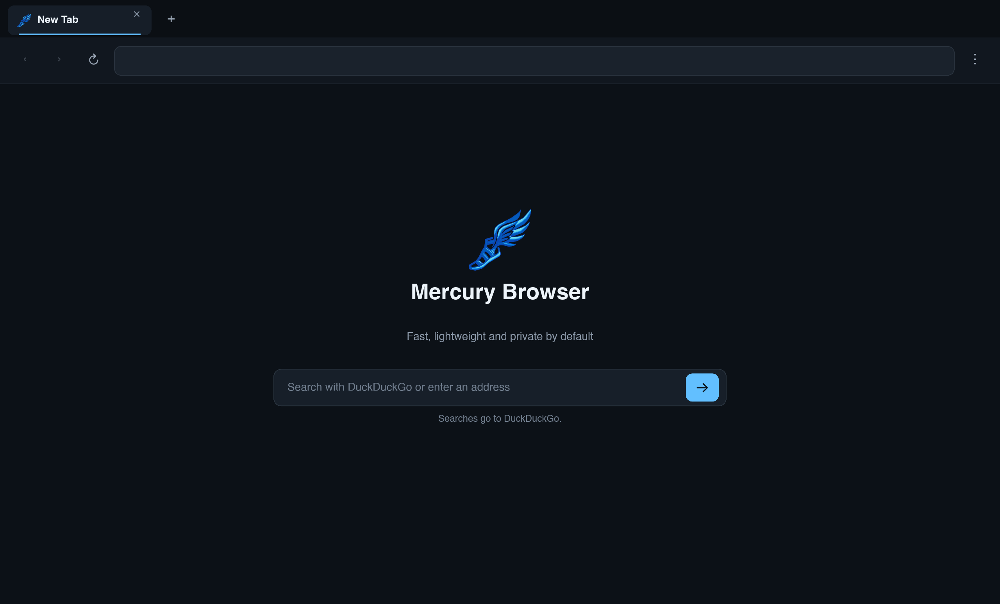
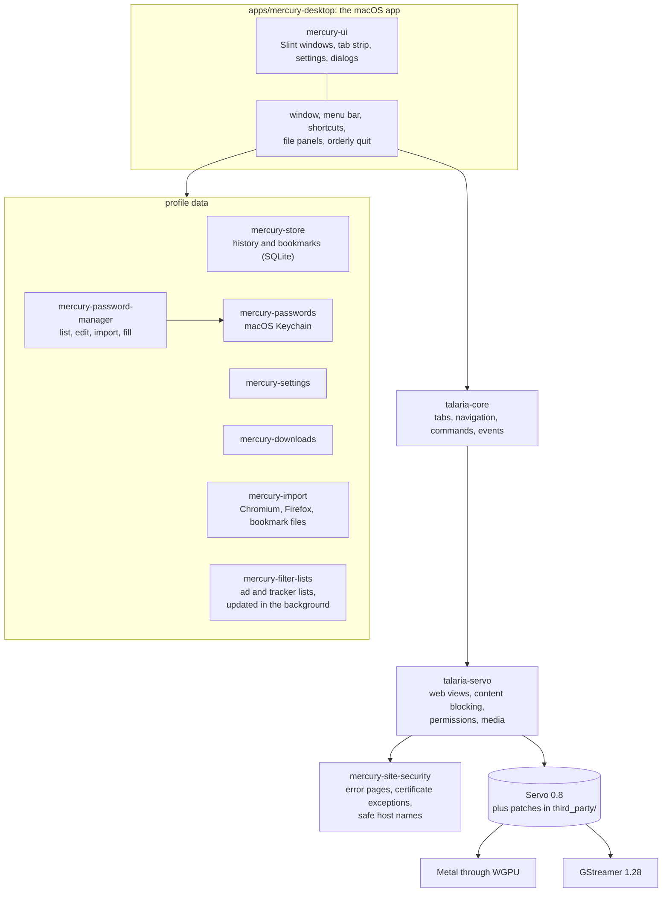
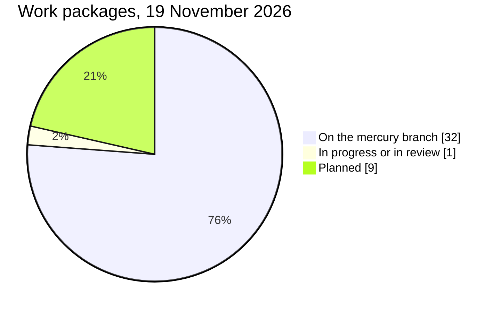

<p align="center">
  
</p>

<p align="center">
  <a href="https://github.com/thepigdestroyer/mercury-browser/actions/workflows/ci.yml?query=branch%3Amercury"></a>
  
  
  
  <a href="LICENSE"></a>
</p>

<p align="center">
  <a href="https://thepigdestroyer.github.io/mercury-browser/"><strong>Documentation</strong></a>
  ·
  <a href="docs/developer-guide/hands-on-checklist.md"><strong>Hands-on checklist</strong></a>
  ·
  <a href="https://github.com/thepigdestroyer/mercury-browser/releases"><strong>Releases</strong></a>
</p>

Mercury is a desktop web browser written in Rust. [Servo](https://servo.org/) renders the pages. [Slint](https://slint.dev/) draws everything around them: windows, menus, dialogs. What we're after is a complete everyday browser for the Mac with no Chromium and no WebKit anywhere underneath.

It began life as a fork of [Hermes Browser](https://github.com/KaykCaputo/hermes-browser), written by Kayk Caputo, and some Hermes code is still in here. Most of what you'll find was rewritten or added after the fork; the platform changed, the engine is newer, and the interface, which still looks a lot like Hermes (only the logo and the orange accents are Mercury's own so far), is gonna get torn up and redesigned soon(ish). I think of it as a separate project with a Hermes ancestor rather than a Hermes variant. By the end the two will have very little in common. [Origins](#origins) has the details of what came from where.

Why the name? Well, Mercury was the Roman name for Hermes, the messenger god, and the browser core is called **Talaria** after his winged sandals.

<p align="center">
  
  
</p>

> [!IMPORTANT]
> This is a preview. Play with it, hack on it, just don't make it your daily browser or use it for anything sensitive yet. Work happens on the `mercury` branch. `master` has older code and only catches up when a round of work is merged.

> [!WARNING]
> Web pages do run in separate Servo content processes, but none of those processes is sandboxed by the operating system yet. There's also no Apple Developer ID behind the app: it's signed ad hoc, macOS complains the first time you open it, and updates are manual (sorry, hate apple, I do).

## Scope

Mercury is (eventually) meant to be a full browser, not a demo shell around an engine. It should have what people expect from Safari, Firefox or Chrome: tabs, history, bookmarks, downloads, saved logins, permission prompts, find in page, media controls, settings and an orderly quit. All of it drawn natively and running on one engine that isn't Blink, Gecko or WebKit.

Some scoping limits are deliberately small for now:

- macOS comes first, Apple Silicon in particular. I started this project with myself in mind as an end user and what I have is a MacBook. Intel Macs build and run it from source too (the Mac I develop on now is one); only the packaged app and disk image are Apple Silicon only. Linux still compiles and CI tests, though I haven't checked the newest rounds of work there by hand, and Windows isn't being built right now and is a low priority ATM.
- Mercury uses Servo as published, the released `servo` crate (0.8.0). If a feature or a safety check needs the engine changed, that change lives in `third_party/` as a small patch with a note explaining it (the camera and microphone support is one). I am not gonna be forking Servo nor is this meant to serve as a servo alternative in any way.
- Privacy is the default. Ads and trackers are blocked out of the box, an outside service only hears from Mercury when a feature needs one (and you can turn that feature off; the filter-list update, at most once a day, is one), and nothing collects crash reports.
- No extensions, no DRM, no printing. Servo can't do them, so they're off the table until it can.

## Aims

1. **A complete browser on an independent engine.** You shouldn't need to fall back to another browser for everyday browsing. The exception is sites that depend on engine features Servo doesn't have yet, will update as those get added.
2. **Native and quiet.** A real macOS menu bar, macOS file panels, Keychain storage for passwords, Now Playing integration. Windows never steal focus or make noise on their own.
3. **An interface of its own, and yours to shape.** The current windows still follow the look Mercury inherited from Hermes. A complete redesign will replace them, and it will be far more customisable than a typical browser: themes, layouts, and a toolbar arranged the way you want it.
4. **Safe defaults.** No click, no pop-up. The same goes for file pickers and handing a link to another app. Permission requests are out in the open, and your answer lasts for the session unless you tell Mercury to keep it.
5. **Small, reviewable changes.** Every feature gets its own branch and starts with tests; someone other than its author reviews it, and it merges only once the full checks pass. How all of that works is in the developer guide.
6. **Upstream-friendly.** Engine bugs found along the way are written up with file and line references, so they can be fixed in Servo itself.

## How it fits together



| Part | What it does |
| --- | --- |
| `apps/mercury-desktop` | The application: window, menus, shortcuts, file panels, start-up and an orderly quit on every path |
| `crates/mercury-ui` | The Slint interface: tab strip, address bar, settings window, dialogs, pickers, and the history, bookmarks, downloads, find, import and site information views |
| `crates/talaria-core` | Browser logic with no engine inside: tabs, navigation, commands and events, testable with fake web views |
| `crates/talaria-servo` | The bridge to Servo: web views, content blocking, permission and dialog requests, media |
| `crates/mercury-store` | History and bookmarks in SQLite, with search and address-bar suggestions |
| `crates/mercury-settings` | Settings, search engines and their keywords |
| `crates/mercury-passwords` | Saved logins in the macOS Keychain, a password generator, CSV import and export |
| `crates/mercury-password-manager` | The password manager's logic between the Keychain crate and the Settings window: the list, editing, CSV import and export, the Touch ID gate, manual fill and saving HTTP sign-ins |
| `crates/mercury-downloads` | The download engine: fetching files, resuming after an interruption, stopping cleanly at quit |
| `crates/mercury-import` | Reading history and bookmarks from Chromium-based browsers, Firefox and bookmark files |
| `crates/mercury-devtools` | Development and CI tools: the loopback server for `tests/`, the smoke test's screenshot checker and the CI scripts' helpers |
| `crates/mercury-filter-lists` | The ad and tracker filter lists as data files: the manifest and its SHA-256 checks, the compiled engine's cache and the background updates |
| `crates/mercury-site-security` | Site security with no engine inside: safe display of host names, Mercury's network, certificate and crash error pages, and certificate-exception requests |
| `crates/mercury-tab-snapshots` | Small pictures of the open tabs, for the Orbit view, with no engine inside: shrinking a frame to at most 480 by 300 pixels, a store kept in memory under a 128 MB cap, and the rules for when a picture is taken |
| `crates/mercury-iconset` | A build tool: renders the app icon's SVG into the macOS iconset (`scripts/macos/make-icns.sh`) |
| `crates/mercury-release` | A release tool: writes and signs the update manifest (`update.json`) published with each release |
| `crates/mercury-servo-patches` | A build tool: vendors a Servo crate exactly as published, exports Mercury's changes to it as a patch and checks them (`make servo-patches-check`) |
| `third_party/` | Patched copies of a few dependencies, and Servo crates vendored as published so they can be patched, each with a `MERCURY.md` explaining the change |

## Where things stand



| Area | Status | Notes |
| --- | --- | --- |
| Page rendering, GPU compositing through Metal, GPU canvas and WebGL | ✅ Done | |
| Tabs, pages that open tabs, pop-up blocking, pages closing their own tab | ✅ Done | Pop-ups need a click in the page |
| Address bar, seven search engines with keywords such as `@wikipedia` | ✅ Done | DuckDuckGo by default |
| Settings window: search, appearance (Light, Dark, System), home page, clearing data on exit | ✅ Done | |
| Page dialogs, permission prompts, HTTP sign-in | ✅ Done | Prompts never take the keyboard from you |
| Site information: padlock and popover, error pages for network and certificate problems, safe display of look-alike host names, HTTPS-only mode | ✅ Done | Typed `http://` addresses try HTTPS first. HTTPS-only is a setting, off by default. No certificate details yet (Servo doesn't give them) |
| Native drop-down menus, colour picker, macOS file panel, right-click menu | ✅ Done | Pickers open only after a click |
| macOS menu bar and About window | ✅ Done | |
| Quitting cleanly from the window, ⌘Q, the Dock, log-out or a terminal signal | ✅ Done | |
| Audio and video through GStreamer 1.28, bundled with the app | ✅ Done | |
| Ad and tracker blocking at the network level | ✅ Done | EasyList, EasyPrivacy and Brave lists |
| System proxy settings and an HTTP disk cache | ✅ Done | |
| Password storage in the Keychain, profile import, download engine | ✅ Done | Their windows are in the rows below |
| Passwords in Settings: search, edit, generate, CSV import and export, fill a login by hand, save HTTP sign-ins | ✅ Done | Touch ID or your login password first to show, copy or export one. Nothing is filled or saved on its own yet |
| Session restore and reopening closed tabs | ✅ Done | |
| History window, address-bar suggestions and inline completion | ✅ Done | |
| Bookmarks bar and manager, import and export | ✅ Done | |
| Import window for other browsers' data | ✅ Done | Chromium-based browsers and Firefox |
| Downloads list, saving links and pages | ✅ Done | |
| Find in page | ✅ Done | |
| Links opened from other apps and a second launch | ✅ Done | |
| Tab audio indicator, mute, and macOS Now Playing | ✅ Done | |
| Pinned tabs, dragging to reorder, tab search, duplicate tab, close other tabs | ✅ Done | |
| Cut, copy and paste in pages | ✅ Done | A page's own clipboard API (`navigator.clipboard`) stays off for now |
| Camera and microphone | ✅ Done | macOS only. Video calls (WebRTC) aren't supported |
| Location | 🔄 In progress | Off until a Servo patch refuses requests from other sites' frames |
| Filter lists as separate files, updated in the background | ✅ Done | |
| Servo patches: safety checks, frame identity, password autofill hooks, leave-page prompts and more | 🗓️ Planned | Approved. The camera work has landed, and most Servo crates are vendored as published, ready for the rest |
| A completely redesigned, highly customisable interface | 🗓️ Planned | Replaces the look inherited from Hermes |
| Screen-reader labels for Mercury's own windows (toolbar, tabs, address bar, menus, dialogs, Settings and the other windows) | 🔄 In progress | Written into the code, covered by automated tests and read back through macOS's accessibility interface by a test program, but not yet tried with VoiceOver by a person, and not yet run with the GPU renderer. In a long list (history, bookmarks manager) a screen reader reaches only the rows on screen until keyboard scrolling is added. Web pages are not readable by a screen reader yet: VoiceOver sees a page as one item |
| Accessibility of web pages (a screen reader reading what a page says) | 🗓️ Planned | Needs Servo patches |
| Phishing protection, search suggestions, password breach checks, translation, update checks | 🗓️ Planned | Waiting for decisions on providers and keys |
| macOS disk image built and published by CI, signed ad hoc | ✅ Done | No release has been published yet |
| With each release: SHA-256 checksums, a build-provenance attestation, the source of the bundled LGPL libraries and a signed update manifest | ✅ Done | The release workflow makes them once the owner has set up the update signing key. The browser does not check for updates yet |
| macOS releases signed with a Developer ID and notarised | 🗓️ Planned | Needs an Apple Developer ID |

## Problems and limits

Some of this is Servo 0.8. Some of it is just where Mercury happens to be today. Better to read it here than to trip over it.

**From the engine**

- There are no Media Source Extensions. Big video sites mostly stream through that API, in adaptive chunks, so their videos may not play. A plain MP4 or WebM file plays fine.
- DRM, passkeys, extensions, printing, spell-checking, picture-in-picture and WebRTC video calls are all missing too. Camera and microphone capture works on a Mac, but a video-calling site will say your browser isn't supported.
- Servo has no Permissions Policy, and its requests don't say which frame sent them. So location and a page's own clipboard API (`navigator.clipboard`, which a site's own Copy button uses) stay off for now, and in a few places Mercury treats frames more strictly than other browsers do.
- Mercury offers to continue past a certificate warning only for addresses on your own network, and never for a site that insists on HTTPS. What you accept is that one certificate for that one site name, until you quit Mercury: the same certificate under another name, or a different certificate under the same name, is refused. You cannot take an exception back before you quit, and a public site has no way past a certificate error.
- "Leave this page?" shows up on reloads and ordinary navigations. Closing a tab skips it.
- Refuse a navigation while a page is still loading and the page can get stranded in its loading state, because Servo has already stopped it by the time it asks Mercury.
- Content processes don't get an operating-system sandbox.
- Site compatibility is whatever Servo implements. Expect the odd page to look or behave differently than it does elsewhere.

**From where Mercury is right now**

- There's no Apple Developer ID yet. Hence the ad hoc signature and the warning on first launch.
- Updates are manual: the browser has no update check yet. Each release does carry a signed update manifest (`update.json`) for the check that is planned, but nothing reads it today.
- Releases carry an ad-hoc signed macOS disk image (Apple Silicon only) and a Linux x86-64 archive, with SHA-256 checksums and a build-provenance attestation ([how to check them](docs/user-guide/installation.md#verify-a-download)). Neither is notarised, and neither updates itself. No release has been made yet. An Intel Mac builds the app from source with `make run`; `make app-macos` is Apple Silicon only.
- Building is heavy. A cold build compiles the whole of Servo and wants 15–20 GB free while it runs.
- Saved logins sit in the Keychain and you can fill one in by hand (right-click the password field), but Mercury doesn't fill them in or save the ones you type into a page's sign-in form on its own. That needs engine hooks, which are on the patch list.
- Camera and microphone capture is macOS only. Location is built but stays off, as above.

## What's still pending

- Eleven features were in progress; ten have merged (session, history, bookmarks and import, downloads, find, links from other apps, media, camera and microphone, and filter lists). Location is the last: it's built but stays off until a Servo patch tells Mercury which frame is asking.
- The approved Servo patches, each kept in `third_party/` with a note explaining it.
- A ground-up redesign of the interface, with themes, layouts and a toolbar you arrange yourself.
- Accessibility of web pages, and trying the labels of Mercury's own windows with VoiceOver on a real Mac.
- The outside services in the table above, once providers and keys are settled.
- An update check in the browser, using the signed update manifest each release already carries.
- Developer ID signing and notarisation of the macOS release, once there's a Developer ID.
- Finally, merging `mercury` into `master`.

## Quick start

### Download for macOS (Apple Silicon)

No release made by the CI workflow has been published yet. Once one is:

1. Download `Mercury-Browser-<version>-macos-arm64.dmg` from the [latest release](https://github.com/thepigdestroyer/mercury-browser/releases/latest). It needs an M1 or later and macOS 13 Ventura or later. To check the download first, see [Verify a download](docs/user-guide/installation.md#verify-a-download).
2. Open the disk image and drag **Mercury Browser** onto **Applications**.
3. Open it the first time. The app is signed ad hoc and **not notarised by Apple**, so macOS blocks the first launch; choose **Done**, then allow it once:
   - on macOS 13 or 14: Control-click (or right-click) Mercury Browser in Applications, choose **Open**, then **Open** again;
   - on any version, including macOS 15 and later where right-click → Open no longer works: **System Settings → Privacy & Security**, scroll to **Security**, click **Open Anyway**, confirm, and open the app again.

The full steps, and what to do if macOS says the app is damaged, are in [Install Mercury](docs/user-guide/installation.md#the-first-launch-allowing-mercury-past-gatekeeper).

### Build on macOS (Apple Silicon and Intel)

You'll need the Xcode command-line tools and [rustup](https://rustup.rs/). The Rust version is pinned in `rust-toolchain.toml` and installs itself on the first build. Servo's build scripts also need `uv`, or Python 3.11 or later, on your `PATH`.

```bash
git clone https://github.com/thepigdestroyer/mercury-browser.git
cd mercury-browser
git checkout mercury
make gstreamer-macos
make run
make app-macos
```

`make gstreamer-macos` downloads and unpacks GStreamer 1.28.9 for this user only, `make run` builds and starts the optimised browser, and `make app-macos` builds `dist/Mercury Browser.app`.

The steps are the same on an Intel Mac apart from the last, and nothing needs Homebrew:

- If you have no Homebrew, install [`uv` with its standalone installer](https://docs.astral.sh/uv/getting-started/installation/) and let it fetch a Python for Servo's code generator (`uv python install 3.12`). Make sure `~/.local/bin` is on your `PATH`.
- `make gstreamer-macos` fetches GStreamer's universal packages, so it is the same on both kinds of Mac. `make ci-tools` downloads the pinned `shellcheck`, `actionlint` and `cargo-deny` for either.
- The GitHub CLI (`gh`) is optional.
- `make app-macos` and the disk image are Apple Silicon only. On an Intel Mac, start the browser with `make run`.

### Linux

On Debian and Ubuntu, this installs the packages CI uses, then builds and starts Mercury:

```bash
make install-linux-deps
make run
```

On other distributions, install the equivalent compiler, Fontconfig, X11, Wayland and GStreamer development packages.

## Everyday commands

| Command | What it does |
| --- | --- |
| `make doctor` | Check the tools a build needs |
| `make check` | Type-check every target and feature |
| `make fmt` | Format the code |
| `make lint` | Clippy with warnings as errors |
| `make test` | The full test suite |
| `make test-servo-net` | The vendored servo-net tests (part of `make test`) |
| `make qa` | Formatting, lint and tests together |
| `make build-release` | Build the optimised workspace |
| `make app-macos` | Build the macOS app bundle |
| `make package-macos` | Build the app bundle and its disk image |
| `make test-bundle-macos` | Check the bundle's contents and signature |
| `make test-capture-macos` | Check camera and microphone capture with fake devices |
| `make ci-tools` | Download the pinned shellcheck, actionlint and cargo-deny |
| `make deny` | Dependency licences and advisories |
| `make lint-scripts` | Shell scripts and workflows, and the licence headers |
| `make servo-patches-check` | Check `third_party/` against the published crates |
| `make docs` | Build the documentation site |

## Keyboard shortcuts (macOS)

| Shortcut | Action |
| --- | --- |
| `⌘T` / `⌘W` | New tab / close tab |
| `⌘L` | Go to the address bar |
| `⌘R` | Reload |
| `⌘[` or `⌘←` / `⌘]` or `⌘→` | Back / forward |
| `⌃Tab` or `⇧⌘]` / `⌃⇧Tab` or `⇧⌘[` | Next tab / previous tab |
| `⌘1` … `⌘8`, `⌘9` | Go to a tab, go to the last tab |
| `⌘=` / `⌘-` / `⌘0` | Zoom in / zoom out / actual size |
| `⇧⌘T` | Reopen the last closed tab |
| `⇧⌘A` / `⌥⌘W` | Search tabs / close other tabs |
| `⌘F` / `⌘G` / `⇧⌘G` | Find in the page / next match / previous match |
| `⌘D` / `⇧⌘B` / `⌥⌘B` | Bookmark this page / show or hide the bookmarks bar / bookmarks manager |
| `⌘Y` / `⇧⌘⌫` | History / clear browsing data |
| `⇧⌘J` / `⌘S` | Downloads / save the page |
| `⇧⌘M` | Mute or unmute the active tab |
| `⌘,` | Settings |
| `⌘Q` | Quit |

## Documentation

The full documentation is a searchable site at [thepigdestroyer.github.io/mercury-browser](https://thepigdestroyer.github.io/mercury-browser/), built from [`docs/`](docs/index.md):

- the **user guide** covers installation, browsing, downloads, media, the camera and microphone, privacy and troubleshooting;
- the **developer guide** covers setup, architecture, the Servo integration, testing, vendored patches, releases and contributing;
- the **[hands-on checklist](docs/developer-guide/hands-on-checklist.md)** lists what to try by hand on each build, because automated runs can't click, log out or use real devices.

## Contributing

Bug reports, reduced test cases, tests, documentation fixes and focused pull requests are all welcome. Before you send a change, run:

```bash
make qa
```

If a page breaks, try it in Servo's own `servoshell` first. If it breaks there too, the fix belongs in Servo.

Mercury's own tools are Rust or POSIX shell, not scripts in another language: the loopback server for the test pages, the smoke test's screenshot checker and the CI helpers live in `crates/mercury-devtools`. Servo's own build scripts still need Python, as above.

Contributions are accepted under the terms in [CONTRIBUTING.md](CONTRIBUTING.md). They come in under the licence of the files they change, and you agree that I can also offer your contribution under a commercial licence.

The `.opencode/` folder holds project tooling for the AI coding agents used in development: a disk guard that limits how many builds run at once and deletes build output after every round, plus the skill that tells the agents how to work with it.

## Origins

Mercury was originally forked from [Hermes Browser](https://github.com/KaykCaputo/hermes-browser) by Kayk Caputo, a Linux-first browser shell around Servo 0.7. Thanks to Kayk for the starting point. The first tab model, the bridge to Servo and the Slint window all began in Hermes, and Hermes's 38 commits are the first of more than 450 on the `mercury` branch.

Everything since has been Mercury's own work. It moved to a new platform (macOS, on Apple Silicon first and now Intel too) and a newer engine (Servo 0.8, with its own patches), and it gained new crates for history, bookmarks, settings, passwords, downloads, import, site security, filter lists and releases, along with most of the features listed above. Much of the inherited code was rewritten along the way. The interface that still resembles Hermes is next. The files that came from Hermes keep the MPL-2.0 licence Hermes used; see [License](#license).

## License

Mercury Browser is source-available, and free for non-commercial use. Read it, fork it, change it and share your changes for personal use, study, research, hobby projects, or use by a charity, school, public research body or government. Making money from it, or using it in or for a commercial product or service, needs a commercial licence from me: open an issue to ask.

Two licences cover the code, and every file says which one applies in an `SPDX-License-Identifier` line at the top (files that can't hold a comment are listed in [`REUSE.toml`](REUSE.toml)):

- **[PolyForm Noncommercial 1.0.0](LICENSES/PolyForm-Noncommercial-1.0.0.md)** for everything written for Mercury. Copyright © 2026 Mrinal Joshi and the Mercury Browser contributors.
- **[Mozilla Public License 2.0](LICENSES/MPL-2.0.txt)** for the files that came from Hermes Browser or contain code from it (Copyright © 2026 Kayk Caputo), for files adapted from other MPL-2.0 projects such as Servo, and for Mercury's changes to those files.

[LICENSE](LICENSE) explains the split and [NOTICE](NOTICE) has the copyright notice. Versions published before 17 November 2026 were released entirely under the MPL-2.0 and stay available under it. Third-party dependencies, vendored code in `third_party/` and the bundled filter lists keep their own licences and notices. The macOS app also bundles LGPL libraries (GStreamer, FFmpeg, GLib, proxy-libintl and libnice) as separate dynamic libraries, and each release attaches their source. It also bundles libjpeg-turbo: this software is based in part on the work of the Independent JPEG Group.

The frame bridges in `apps/mercury-desktop/src/rendering/` follow Slint's Servo example, and the macOS bridge adapts its `metal.rs` (https://github.com/slint-ui/slint, tag `v1.17.1`, MIT, © SixtyFPS GmbH); see [THIRD-PARTY-NOTICES.md](THIRD-PARTY-NOTICES.md) and [LICENSES/MIT-slint-examples.txt](LICENSES/MIT-slint-examples.txt).
