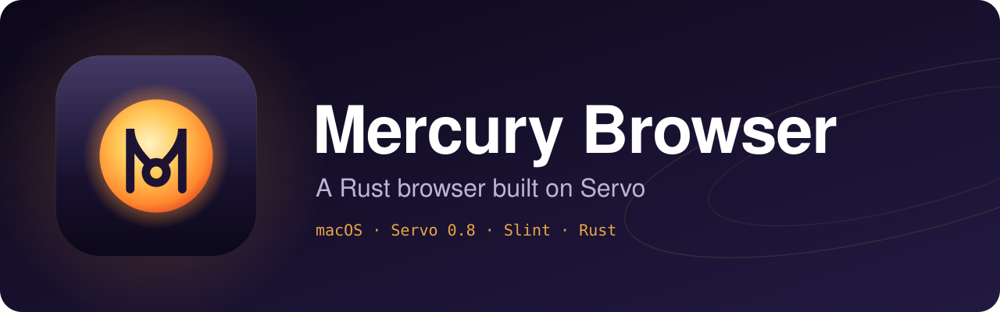
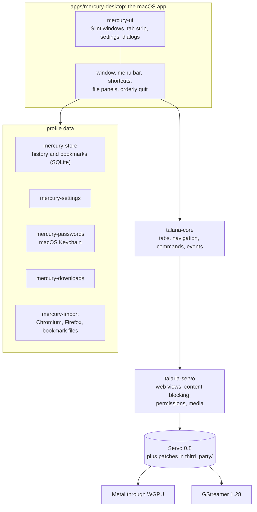
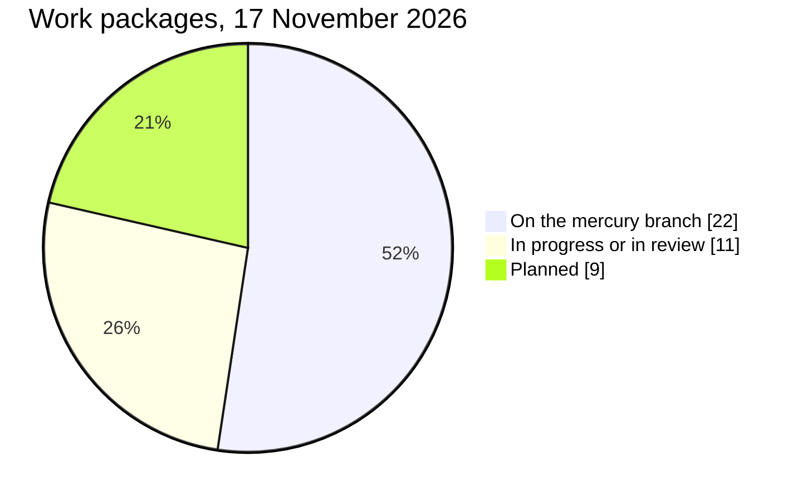

<p align="center">
  
</p>

<p align="center">
  <a href="https://github.com/thepigdestroyer/mercury-browser/actions/workflows/ci.yml?query=branch%3Amercury"></a>
  
  
  
  <a href="LICENSE"></a>
</p>

<p align="center">
  <a href="https://thepigdestroyer.github.io/mercury-browser/"><strong>Documentation</strong></a>
  ·
  <a href="docs/developer-guide/hands-on-checklist.md"><strong>Hands-on checklist</strong></a>
  ·
  <a href="https://github.com/thepigdestroyer/mercury-browser/releases"><strong>Releases</strong></a>
</p>

Mercury is a desktop web browser written in Rust. [Servo](https://servo.org/) renders the pages. [Slint](https://slint.dev/) draws everything around them: windows, menus, dialogs. What we're after is a complete everyday browser for the Mac with no Chromium and no WebKit anywhere underneath.

It began life as a fork of [Hermes Browser](https://github.com/KaykCaputo/hermes-browser), written by Kayk Caputo, and some Hermes code is still in here. Most of what you'll find was rewritten or added after the fork; the platform changed, the engine is newer, and the interface, which still looks a lot like Hermes, is gonna get torn up and redesigned soon(ish). I think of it as a separate project with a Hermes ancestor rather than a Hermes variant. By the end the two will have very little in common. [Origins](#origins) has the details of what came from where.

Why the name? Well, Mercury was the Roman name for Hermes, the messenger god, and the browser core is called **Talaria** after his winged sandals.

> [!IMPORTANT]
> This is a preview. Play with it, hack on it, just don't make it your daily browser or use it for anything sensitive yet. Work happens on the `mercury` branch. `master` has older code and only catches up when a round of work is merged.

> [!WARNING]
> Web pages do run in separate Servo content processes, but none of those processes is sandboxed by the operating system yet. There's also no Apple Developer ID behind the app: it's signed ad hoc, macOS complains the first time you open it, and updates are manual (sorry, hate apple, I do).

## Scope

Mercury is (eventually) meant to be a full browser, not a demo shell around an engine. It should have what people expect from Safari, Firefox or Chrome: tabs, history, bookmarks, downloads, saved logins, permission prompts, find in page, media controls, settings and an orderly quit. All of it drawn natively and running on one engine that isn't Blink, Gecko or WebKit.

Some scoping limits are deliberately small for now:

- macOS comes first, Apple Silicon in particular. I started this project with myself in mind as an end user and what I have is a MacBook. Linux still compiles and CI tests but Windows isn't being built right now and is a low priority ATM.
- Mercury uses Servo as published, the released `servo` crate (0.8.0). If a feature or a safety check needs the engine changed, that change lives in `third_party/` as a small patch with a note explaining it. I am not gonna be forking Servo nor is this meant to serve as a servo alternative in any way.
- Privacy is the default. Ads and trackers are blocked out of the box, an outside service only hears from Mercury when a feature needs one (and you can turn that feature off), and nothing collects crash reports.
- No extensions, no DRM, no printing. Servo can't do them, so they're off the table until it can.

## Aims

1. **A complete browser on an independent engine.** You shouldn't need to fall back to another browser for everyday browsing. The exception is sites that depend on engine features Servo doesn't have yet, will update as those get added.
2. **Native and quiet.** A real macOS menu bar, macOS file panels, Keychain storage for passwords, Now Playing integration. Windows never steal focus or make noise on their own.
3. **An interface of its own, and yours to shape.** The current windows still follow the look Mercury inherited from Hermes. A complete redesign will replace them, and it will be far more customisable than a typical browser: themes, layouts, and a toolbar arranged the way you want it.
4. **Safe defaults.** No click, no pop-up. The same goes for file pickers and handing a link to another app. Permission requests are out in the open, and your answer lasts for the session unless you tell Mercury to keep it.
5. **Small, reviewable changes.** Every feature gets its own branch and starts with tests; someone other than its author reviews it, and it merges only once the full checks pass. How all of that works is in the developer guide.
6. **Upstream-friendly.** Engine bugs found along the way are written up with file and line references, so they can be fixed in Servo itself.

## How it fits together



| Part | What it does |
| --- | --- |
| `apps/mercury-desktop` | The application: window, menus, shortcuts, file panels, start-up and an orderly quit on every path |
| `crates/mercury-ui` | The Slint interface: tab strip, address bar, settings window, dialogs, pickers |
| `crates/talaria-core` | Browser logic with no engine inside: tabs, navigation, commands and events, testable with fake web views |
| `crates/talaria-servo` | The bridge to Servo: web views, content blocking, permission and dialog requests, media |
| `crates/mercury-store` | History and bookmarks in SQLite, with search and address-bar suggestions |
| `crates/mercury-settings` | Settings, search engines and their keywords |
| `crates/mercury-passwords` | Saved logins in the macOS Keychain, a password generator, CSV import and export |
| `crates/mercury-downloads` | The download engine: fetching files, resuming after an interruption, stopping cleanly at quit |
| `crates/mercury-import` | Reading history and bookmarks from Chromium-based browsers, Firefox and bookmark files |
| `third_party/` | Patched copies of a few dependencies, each with a `MERCURY.md` explaining the change |

## Where things stand



| Area | Status | Notes |
| --- | --- | --- |
| Page rendering, GPU compositing through Metal, GPU canvas and WebGL | ✅ Done | |
| Tabs, pages that open tabs, pop-up blocking, pages closing their own tab | ✅ Done | Pop-ups need a click in the page |
| Address bar, seven search engines with keywords such as `@wikipedia` | ✅ Done | DuckDuckGo by default |
| Settings window: search, appearance (Light, Dark, System), home page, clearing data on exit | ✅ Done | |
| Page dialogs, permission prompts, HTTP sign-in | ✅ Done | Prompts never take the keyboard from you |
| Native drop-down menus, colour picker, macOS file panel, right-click menu | ✅ Done | Pickers open only after a click |
| macOS menu bar and About window | ✅ Done | |
| Quitting cleanly from the window, ⌘Q, the Dock, log-out or a terminal signal | ✅ Done | |
| Audio and video through GStreamer 1.28, bundled with the app | ✅ Done | |
| Ad and tracker blocking at the network level | ✅ Done | EasyList, EasyPrivacy, uBlock Origin and Brave lists |
| System proxy settings and an HTTP disk cache | ✅ Done | |
| Password storage in the Keychain, profile import, download engine | ✅ Done | The windows for these are in progress |
| Session restore and reopening closed tabs | 🔄 In progress | |
| History window, address-bar suggestions and inline completion | 🔄 In progress | |
| Bookmarks bar and manager, import and export | 🔄 Approved | Merges after history |
| Import window for other browsers' data | 🔄 Approved | Merges after history |
| Downloads list, saving links and pages | 🔄 Approved | |
| Find in page | 🔄 Approved | |
| Links opened from other apps and a second launch | 🔄 Approved | |
| Tab audio indicator, mute, and macOS Now Playing | 🔄 In review | |
| Camera and microphone | 🔄 In review | macOS only |
| Location | 🔄 In progress | Off until a Servo patch refuses requests from other sites' frames |
| Filter lists as separate files, updated in the background | 🔄 In progress | |
| Servo patches: safety checks, frame identity, password autofill hooks, leave-page prompts and more | 🗓️ Planned | Approved, start once the camera work lands |
| A completely redesigned, highly customisable interface | 🗓️ Planned | Replaces the look inherited from Hermes |
| Accessibility of Mercury's own windows | 🗓️ Planned | |
| Phishing protection, search suggestions, password breach checks, translation, update checks | 🗓️ Planned | Waiting for decisions on providers and keys |
| macOS releases from CI, signed and notarised | 🗓️ Planned | Needs an Apple Developer ID |

## Problems and limits

Some of this is Servo 0.8. Some of it is just where Mercury happens to be today. Better to read it here than to trip over it.

**From the engine**

- There are no Media Source Extensions. Big video sites mostly stream through that API, in adaptive chunks, so their videos may not play. A plain MP4 or WebM file plays fine.
- DRM, passkeys, extensions, printing, spell-checking and picture-in-picture are all missing too.
- Servo has no Permissions Policy, and its requests don't say which frame sent them. So location stays off for now, and in a few places Mercury treats frames more strictly than other browsers do.
- "Leave this page?" shows up on reloads and ordinary navigations. Closing a tab skips it.
- Refuse a navigation while a page is still loading and the page can get stranded in its loading state, because Servo has already stopped it by the time it asks Mercury.
- Content processes don't get an operating-system sandbox.
- Site compatibility is whatever Servo implements. Expect the odd page to look or behave differently than it does elsewhere.

**From where Mercury is right now**

- There's no Apple Developer ID yet. Hence the ad hoc signature, the warning on first launch, and no automatic updates.
- The release workflow only publishes a Linux x86-64 archive; on a Mac, `make app-macos` builds the app.
- Building is heavy. A cold build compiles the whole of Servo and wants 15–20 GB free while it runs.
- Saved logins sit in the Keychain but don't get filled into pages. That needs engine hooks, which are on the patch list.

## What's still pending

- Eleven features are in progress. They'll merge in this order: session, history, bookmarks and import, downloads, find, links from other apps, and then media, camera, location and filter lists.
- The approved Servo patches, each kept in `third_party/` with a note explaining it.
- A ground-up redesign of the interface, with themes, layouts and a toolbar you arrange yourself.
- Accessibility for Mercury's own windows.
- The outside services in the table above, once providers and keys are settled.
- macOS release builds in CI. Signing comes once there's a Developer ID.
- Finally, merging `mercury` into `master`.

## Quick start

### macOS (Apple Silicon)

You'll need the Xcode command-line tools and [rustup](https://rustup.rs/). The Rust version is pinned in `rust-toolchain.toml` and installs itself on the first build.

```bash
git clone https://github.com/thepigdestroyer/mercury-browser.git
cd mercury-browser
git checkout mercury
make gstreamer-macos   # downloads and unpacks GStreamer 1.28.9 for this user only
make run               # builds and starts the optimised browser
make app-macos         # builds dist/Mercury Browser.app
```

### Linux

```bash
make install-linux-deps   # Debian and Ubuntu; installs the packages CI uses
make run
```

On other distributions, install the equivalent compiler, Fontconfig, X11, Wayland and GStreamer development packages.

## Everyday commands

```bash
make doctor          # Check the tools a build needs
make check           # Type-check every target and feature
make fmt             # Format the code
make lint            # Clippy with warnings as errors
make test            # The full test suite
make qa              # Formatting, lint and tests together
make build-release   # Build the optimised workspace
make app-macos       # Build the macOS app bundle
make test-bundle-macos  # Check the bundle's contents and signature
make deny            # Dependency licences and advisories
make lint-scripts    # Shell scripts and workflows
make docs            # Build the documentation site
```

## Keyboard shortcuts (macOS)

| Shortcut | Action |
| --- | --- |
| `⌘T` / `⌘W` | New tab / close tab |
| `⌘L` | Go to the address bar |
| `⌘R` | Reload |
| `⌘[` or `⌘←` / `⌘]` or `⌘→` | Back / forward |
| `⌃Tab` or `⇧⌘]` / `⌃⇧Tab` or `⇧⌘[` | Next tab / previous tab |
| `⌘1` … `⌘8`, `⌘9` | Go to a tab, go to the last tab |
| `⌘=` / `⌘-` / `⌘0` | Zoom in / zoom out / actual size |
| `⌘,` | Settings |
| `⌘Q` | Quit |

## Documentation

The full documentation is a searchable site at [thepigdestroyer.github.io/mercury-browser](https://thepigdestroyer.github.io/mercury-browser/), built from [`docs/`](docs/index.md):

- the **user guide** covers installation, browsing, media, privacy and troubleshooting;
- the **developer guide** covers setup, architecture, the Servo integration, testing, vendored patches, releases and contributing;
- the **[hands-on checklist](docs/developer-guide/hands-on-checklist.md)** lists what to try by hand on each build, because automated runs can't click, log out or use real devices.

## Contributing

Bug reports, reduced test cases, tests, documentation fixes and focused pull requests are all welcome. Before you send a change, run:

```bash
make qa
```

If a page breaks, try it in Servo's own `servoshell` first. If it breaks there too, the fix belongs in Servo.

Contributions are accepted under the terms in [CONTRIBUTING.md](CONTRIBUTING.md). They come in under the licence of the files they change, and you agree that I can also offer your contribution under a commercial licence.

The `.opencode/` folder holds project tooling for the AI coding agents used in development: a disk guard that limits how many builds run at once and deletes build output after every round, plus the skill that tells the agents how to work with it.

## Origins

Mercury was originally forked from [Hermes Browser](https://github.com/KaykCaputo/hermes-browser) by Kayk Caputo, a Linux-first browser shell around Servo 0.7. Thanks to Kayk for the starting point. The first tab model, the bridge to Servo and the Slint window all began in Hermes, and Hermes's 38 commits are the first of more than 300 on the `mercury` branch.

Everything since has been Mercury's own work. It moved to a new platform (macOS on Apple Silicon) and a newer engine (Servo 0.8, with its own patches), and it gained new crates for history, bookmarks, settings, passwords, downloads and import, along with most of the features listed above. Much of the inherited code was rewritten along the way. The interface that still resembles Hermes is next. The files that came from Hermes keep the MPL-2.0 licence Hermes used; see [License](#license).

## License

Mercury Browser is source-available, and free for non-commercial use. Read it, fork it, change it and share your changes for personal use, study, research, hobby projects, or use by a charity, school, public research body or government. Making money from it, or using it in or for a commercial product or service, needs a commercial licence from me: open an issue to ask.

Two licences cover the code, and every file says which one applies in an `SPDX-License-Identifier` line at the top (files that can't hold a comment are listed in [`REUSE.toml`](REUSE.toml)):

- **[PolyForm Noncommercial 1.0.0](LICENSES/PolyForm-Noncommercial-1.0.0.md)** for everything written for Mercury. Copyright © 2026 Mrinal Joshi and the Mercury Browser contributors.
- **[Mozilla Public License 2.0](LICENSES/MPL-2.0.txt)** for the files that came from Hermes Browser or contain code from it (Copyright © 2026 Kayk Caputo), for files adapted from other MPL-2.0 projects such as Servo, and for Mercury's changes to those files.

[LICENSE](LICENSE) explains the split and [NOTICE](NOTICE) has the copyright notice. Versions published before 17 November 2026 were released entirely under the MPL-2.0 and stay available under it. Third-party dependencies, vendored code in `third_party/` and the bundled filter lists keep their own licences and notices.

The frame bridges in `apps/mercury-desktop/src/rendering/` follow Slint's Servo example, and the macOS bridge adapts its `metal.rs` (https://github.com/slint-ui/slint, tag `v1.17.1`, MIT, © SixtyFPS GmbH); see [THIRD-PARTY-NOTICES.md](THIRD-PARTY-NOTICES.md) and [LICENSES/MIT-slint-examples.txt](LICENSES/MIT-slint-examples.txt).
