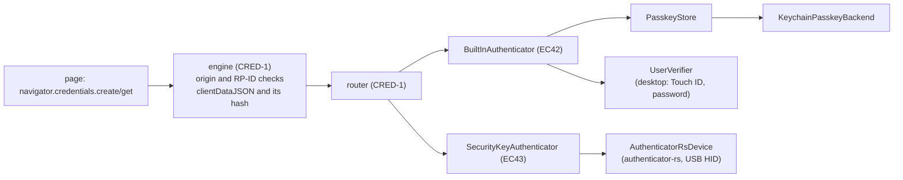

# Passkeys and security keys

`crates/mercury-passkeys` is the Servo-free core of Mercury's passkey support (R14 items EC42, EC43 and EC46). It has no
interface and is not connected to the engine yet: the engine half (`navigator.credentials` and `PublicKeyCredential`,
item EC41, lane CRED-1) and the passkey screens are later lanes, and this page records what they call. Third-party
managers (EC44) sit in front of all this through their browser extensions; phone sign-in (EC45) is later.

Mercury has **no Apple platform passkeys and no iCloud Keychain** (decision O-31): Apple gives them only to apps with a
request-only entitlement. Mercury's own manager keeps passkeys in the user's login keychain on this Mac.



## The contract the engine calls

The engine checks the page's origin and relying party id, builds `clientDataJSON` and hashes it, then calls a
`PasskeyAuthenticator` (`src/ctap.rs`) with that hash. The calls **block** until the user has answered, so the engine
runs them on a worker thread and turns the result into the page's promise.

```rust
trait PasskeyAuthenticator: Send + Sync {
    fn kind(&self) -> AuthenticatorKind;                       // BuiltIn | SecurityKey
    fn make_credential(&self, &CreateRequest) -> Result<CreateResponse, PasskeyError>;
    fn get_assertion(&self, &AssertRequest) -> Result<AssertResponse, PasskeyError>;
    fn cancel(&self);                                          // from another thread
}
```

| Type | What it holds |
| --- | --- |
| `CreateRequest` | origin (for the prompt), `rp`, `user`, `client_data_hash`, `algorithms` (COSE numbers), `exclude` ids, `resident_key`, `user_verification`, `timeout_ms` |
| `CreateResponse` | `credential_id` (`rawId`), `attestation_object` (CBOR), `authenticator_data`, `public_key_algorithm`, `public_key_spki`, `transports`, `attachment`, `kind` |
| `AssertRequest` | origin, `rp_id`, `client_data_hash`, `allow` ids (empty: any discoverable passkey of the site), `user_verification`, `timeout_ms` |
| `AssertResponse` | `credential_id`, `authenticator_data`, `signature`, `user_handle`, `attachment`, `kind` |

`PasskeyError::dom_exception_name()` gives the `DOMException` a page should see (`NotAllowedError` for a declined
prompt or an unknown passkey, so a page cannot tell which; `InvalidStateError` for an excluded credential;
`NotSupportedError`; `AbortError`; `TypeError`). Errors carry fixed texts only and are safe to log.

A router (the engine lane's) tries the built-in manager when it holds a matching passkey and a security key otherwise,
or when the page asks for `cross-platform`. Nothing in this crate chooses between authenticators.

## The built-in manager (EC42)

`BuiltInAuthenticator::new(Arc<PasskeyStore<B>>, Arc<dyn UserVerifier>)` wraps 1Password's `passkey` 0.6 software
authenticator with three adapters (`src/builtin.rs`): `PasskeyCredentialStore` (storage), `UserValidation` (the user) and
`MercuryCrypto` (`src/crypto.rs`: ES256 only, randomness from `getrandom`). It differs from passkey-rs on purpose:

- **ES256 only.** The key comes from `p256`'s `Generate::generate()`, which uses the operating system's random source;
  Ed25519 and ML-DSA keys in passkey-rs come from `rand::rng()`, a CSPRNG seeded from the OS. A page that offers only
  other algorithms gets `NotSupportedError`. The credential id (16 to 64 bytes) and all other randomness go through
  `getrandom`; `BuiltInAuthenticator::new` probes it and the process aborts rather than use weak bytes if it fails later.
- **Attestation `none` and an all-zero AAGUID**, as WebAuthn asks a client to do for `none` attestation.
- **No signature counter** (`counter: None`), as syncable passkeys should have.
- **Every passkey is discoverable** and keeps its user handle and names, so it can be listed and shown in the account
  picker. With two or more passkeys for a site and no allow list, `UserVerifier::choose_passkey` picks one.
- **The exclude list works.** passkey-rs 0.6 asks about an excluded credential and then creates a new one anyway;
  Mercury fails with `CredentialExcluded` after the user has acknowledged the prompt.
- **A second passkey for the same account does not replace the first** (CTAP says it should): deleting a passkey before
  the site has accepted the new one could lock the user out. Both stay, newest first, and the user can delete the old one.
- **No prompt for a request that cannot succeed** (bad RP id, unsupported algorithm, `Required` verification without a
  capable verifier); a request that fails after the user is involved still shows the prompt, so a page learns nothing
  without the user.
- A private key is read from the store only when passkey-rs asks for it, after the user approved.

passkey-rs sets the "backup eligible" and "backed up" flags in the authenticator data of every passkey and Mercury cannot
change that: until Mercury's own sync exists a site is told a passkey is backed up when it is not (open item).

### The user-verification hook

`UserVerifier` (`src/verifier.rs`) is what the desktop implements in a later lane: a sheet naming the site and account,
then Touch ID with the account password as the fallback (`LAPolicy.deviceOwnerAuthentication`).

```rust
trait UserVerifier: Send + Sync {
    fn capabilities(&self) -> VerifierCapabilities;            // presence, verification: Some(true) | Some(false) | None
    fn verify(&self, &VerificationRequest) -> Result<Verification, PasskeyError>;
    fn choose_passkey(&self, origin: &str, &[PasskeySummary]) -> Result<Option<usize>, PasskeyError>;
    fn cancel(&self);
}
```

A `VerificationRequest` carries the origin, the purpose (`CreatePasskey { rp, user }`, `UsePasskey(summary)`,
`ExcludedPasskeyFound(summary)`, `NoPasskeyFound { rp_id }`) and whether presence and verification are required. A passkey
is never created or used without a `verify` call that returned presence. `testing::FakeVerifier` scripts the answers.

### Listing and deleting (the passkey screens)

`PasskeyStore<B>` (`src/store.rs`) is what the settings page calls: `all()`, `for_rp(rp_id)`, `find(rp_id, allow)`,
`save(&record)` (validated: lower-case host names, id lengths, no control characters), `record(&key)` (the only call that
reads a private key), `remove(&key)`, `remove_for_rp(rp_id)`, `remove_all()`, `set_counter`. Everything but `record`
returns `PasskeySummary`, which has no private key and a `Debug` that shows only lengths. Matching is by exact relying
party id: nothing matches subdomains.

## Storage on macOS

`keychain::KeychainPasskeyBackend` (modelled on `mercury-passwords`) keeps **one generic-password Keychain item per
passkey** in a keychain it names explicitly (`login()` resolves the user's default keychain and passes it like any other;
`file(path, password)` is for tests and refuses `login.keychain*` names and the system Keychains folders):

| Item field | Content |
| --- | --- |
| service | `io.github.thepigdestroyer.mercury-browser.passkeys` |
| account | `v1\|<rp_id>\|<base64url credential id>` |
| label, description | `<rp_id> (<user name>)`, `Mercury Browser passkey` |
| comment | a small JSON object: user handle, user name, display name, counter, algorithm (no secret) |
| data | the private COSE_Key (CBOR), encrypted by the Keychain |

Listing reads attributes only and never asks the user. The access list is **explicit**: each item is added with a
`SecAccess` that trusts this application only (`AccessPolicy::ThisApplicationOnly`, a field of the backend, so a later
step such as a Developer ID or the data-protection keychain changes a value and not the code path), and a test reads the
list back. The data-protection keychain (`kSecAttrAccessControl` with biometry) needs an entitlement and a signed app, so
Touch ID gating is the `UserVerifier`'s job. Reading a secret that the Keychain would ask about fails with `Locked` when
user interaction is switched off (`KeychainPasskeyBackend::without_user_interaction`).

**The private key is never in a plain file.** `tests/no_plaintext_key.rs` makes a passkey through the built-in manager on
a real temporary keychain and searches every file under the directory for the key as raw bytes, hex, base64, base64url,
as a COSE_Key and as PKCS#8. The only place a key leaves the store in the clear is a CXF export (below).

Secrets are `Zeroizing` where this crate holds them (`PrivateKey`, the buffer handed to the Keychain, PINs, exports). The
dependencies keep copies this crate cannot wipe: passkey-rs's `CoseKey`, a copy inside Core Foundation when a secret is
read, `serde_json` and the CXF types during an import.

## Security keys (EC43)

`usb::SecurityKeyAuthenticator<D: SecurityKeyDevice>` implements the same trait for a USB key. `SecurityKeyDevice` is the
seam: `usb_hid::AuthenticatorRsDevice` (macOS) drives Mozilla's `authenticator` 0.5 (`AuthenticatorService`, CTAP2 over
HID, `crypto_rust`), converting requests, pumping its status channel into the `SecurityKeyUi` trait (touch, PIN with
retries, wrong PIN, blocked states, select device) and converting the results. Attestation is dropped (`none`, zero
AAGUID) so a key's batch certificate never reaches a site. The call times out after the page's timeout (default 120 s,
capped at 300 s). The `authenticator` dependency is **macOS only**: it needs `libudev` on Linux, which CI does not
install. A UI's `pin()` must return `None` when `cancelled()` is called, because the library cannot stop while it waits
for a PIN.

Tests never touch a device: `testing::FakeSecurityKey` replaces the device, and `testing::FakeTransport` replaces the
HID transport below `AuthenticatorService`, so the real conversion code runs against canned results made by the
built-in authenticator (a cross-check of both libraries' CBOR).

## Import and export (EC46)

`cxf` reads and writes the FIDO Credential Exchange Format (`credential-exchange-format` 0.4, version 1.0):

- `export_cxf(&records, ExportAcknowledgement::PrivateKeysInClear, now_secs)` returns an `Exported` (zeroising bytes,
  `exported` count, `skipped` reasons). **An export holds private keys in the clear** (PKCS#8, base64url), so the call
  cannot be made without naming the acknowledgement: the interface must have warned the user first.
  `write_export_file(path, &exported)` creates the file with mode 0600 and `create_new` (it never overwrites or follows
  a link) and removes a partial file on error. Passkeys with no user handle (CXF needs one) or a counter are left out
  and counted.
- `import_cxf(bytes)` (read the file with `read_import_file`, which limits and wipes) refuses a file as a whole when it
  is not valid CXF 1.0 JSON, is over 64 MiB or 100,000 items, or holds a passkey whose key is not a PKCS#8 ES256 key or
  breaks the store's rules; it never imports part of a file. Passwords, notes and other credentials are skipped and
  counted by kind (`Imported::skipped_kinds`); keys of other algorithms and passkeys with extensions it cannot keep are
  skipped and counted (`SkipReason`).
- Not done: encrypting the export (the CXP protocol, or a passphrase container, would add crypto dependencies to
  credential code), and passwords in CXF (they belong with `mercury-passwords`).

## Dependencies and licences

`passkey` 0.6.0 (MIT OR Apache-2.0, used under MIT), `credential-exchange-format` 0.4.0 (MIT) and `authenticator` 0.5.0
(MPL-2.0, linked unmodified) are pinned in the workspace `Cargo.toml` and listed in `THIRD-PARTY-NOTICES.md`; the credits
page carries their texts (`crates/mercury-credits/credits.toml` names the holders of the crates that ship no licence
file). `deny.toml` carries one exception, RUSTSEC-2026-0387 for `crypto-bigint` 0.5.5, which `authenticator` 0.5.0 pulls in
through `p256` 0.13 for one ephemeral key exchange per PIN; it goes when `authenticator` moves to `p256` 0.14.

## Testing

`cargo test --release -p mercury-passkeys` (about 220 tests, no engine, no device, no Touch ID; the Keychain tests use
temporary keychain files with user interaction switched off). `--features testing` exposes `FakeVerifier`,
`FakeSecurityKey` and `FakeTransport` to other crates' tests. Real-device checks are in `sdd/deferred-hands-on.md`,
section G.
