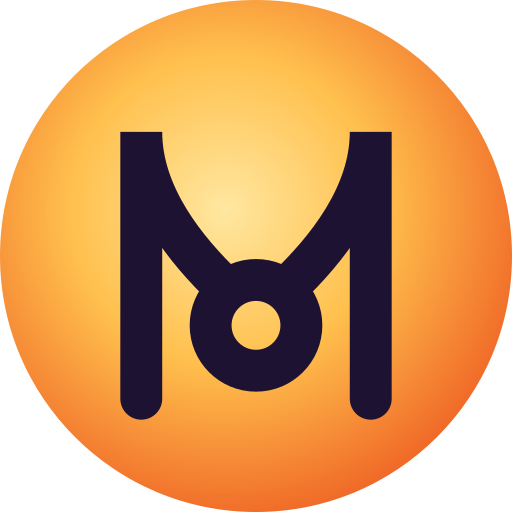
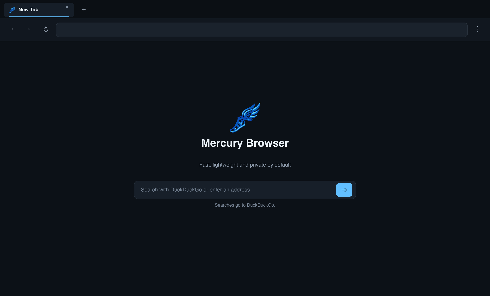
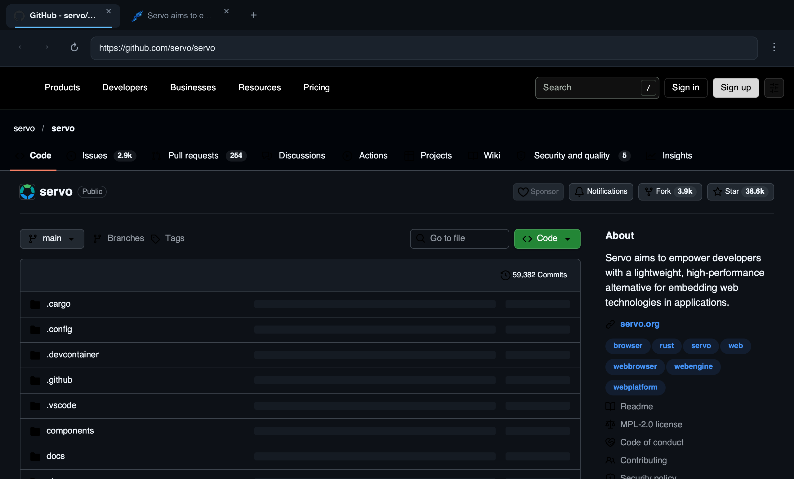

<section class="mercury-hero">
  

    

      
      Mercury Browser
    

    <h1>A desktop browser in Rust, on the Servo engine.</h1>
    
Servo renders the pages and Slint draws the windows, menus and dialogs around them. Mercury is built for macOS on Apple Silicon first, and it builds and runs from source on Intel Macs too. It is a preview: try it and work on it, but don't use it for anything sensitive yet.

    

      <a href="user-guide/installation/" class="md-button md-button--primary">Install Mercury</a>
      <a href="developer-guide/" class="md-button">Developer guide</a>
    

  

  

    
  

</section>

  

    <strong>Servo 0.8</strong>
    The published engine, with a few small patches kept against the crates vendored in third_party/
  

  

    <strong>macOS on Apple Silicon</strong>
    Metal rendering, a native menu bar, macOS file panels, the Keychain. Disk images are Apple Silicon only; Intel Macs build from source
  

  

    <strong>GStreamer 1.28</strong>
    Audio and video, bundled inside the app
  

<section class="mercury-section">
  

    
Two guides

    <h2>Using Mercury, or working on it.</h2>
    
The user guide covers installing and using the browser and what it can't do yet. The developer guide covers building it, how the code is laid out, and how changes are tested.

  

  

    <article class="mercury-card">
      USER GUIDE
      <h3>Install and browse</h3>
      
Install Mercury, use tabs, search and shortcuts, play media, use the camera and microphone, read what Mercury blocks and stores, and fix common problems.

      <a href="user-guide/">Open the user guide →</a>
    </article>
    <article class="mercury-card">
      DEVELOPER GUIDE
      <h3>Build and change it</h3>
      
Set up a build on Apple Silicon or Intel, follow commands and frames through the crates, run the checks, and keep the Servo patches small.

      <a href="developer-guide/">Open the developer guide →</a>
    </article>
  

</section>

<section class="mercury-section">
  

    
On the mercury branch today

    <h2>What works now.</h2>
  

  

    <article class="mercury-card">
      01
      <h3>Pages and tabs</h3>
      
GPU compositing through Metal, GPU 2D canvas and WebGL. Tabs, pages that open tabs, pop-up blocking, zoom and page full screen. Tabs can be pinned, searched, duplicated and dragged into order. Your tabs can come back after a restart, and a closed tab can be reopened.

    </article>
    <article class="mercury-card">
      02
      <h3>Address bar and search</h3>
      
Seven search engines, DuckDuckGo by default, with keywords such as <code>@wikipedia</code>. You can add your own engines in Settings.

    </article>
    <article class="mercury-card">
      03
      <h3>Native macOS parts</h3>
      
A menu bar, an About window, the macOS file panel, a right-click menu, drop-down lists and a colour picker. Pickers open only after a click. Links from other apps open in new tabs, and macOS Now Playing and the media keys follow the tab that is playing.

    </article>
    <article class="mercury-card">
      04
      <h3>Dialogs and prompts</h3>
      
Page alerts, confirmations, text prompts, HTTP sign-in and permission prompts. None of them take the keyboard away from you. A page that wants to open another app's link, such as a mail address, asks first.

    </article>
    <article class="mercury-card">
      05
      <h3>Blocking and privacy</h3>
      
Ads and trackers blocked at the network level with EasyList, EasyPrivacy and Brave lists, updated in the background. Choose what is cleared when Mercury quits.

    </article>
    <article class="mercury-card">
      06
      <h3>Audio and video</h3>
      
MP4 (H.264, AAC), WebM (VP9, Opus), MP3 and WAV, decoded by the GStreamer copy inside the app. Sites that stream through Media Source Extensions may not play. A tab that is playing sound shows a speaker you can click to mute it.

    </article>
    <article class="mercury-card">
      07
      <h3>History and bookmarks</h3>
      
A history window with search, address-bar suggestions from your own history and bookmarks, a bookmark star and bar, a bookmarks manager, and an import window for Chromium-based browsers and Firefox.

    </article>
    <article class="mercury-card">
      08
      <h3>Downloads and find</h3>
      
A downloads list with progress, cancel and resume, Save page as…, and a bar that asks before a page starts a download on its own. Find in page opens a find bar under the toolbar.

    </article>
    <article class="mercury-card">
      09
      <h3>Saved logins</h3>
      
Logins kept in the macOS Keychain and managed in Settings: search, edit, generate, and import or export CSV. Showing, copying and exporting ask for Touch ID or your password. Fill a login from the right-click menu on a password field.

    </article>
    <article class="mercury-card">
      10
      <h3>Site security</h3>
      
A padlock and a site information popover in the address bar. Typed <code>http://</code> addresses are tried over HTTPS first, an HTTPS-only mode is there to switch on, and network and certificate errors get Mercury's own pages.

    </article>
    <article class="mercury-card">
      11
      <h3>Camera and microphone</h3>
      
On macOS, sites can ask to use them. Nothing opens before you allow it, and a red mark and a Stop button show while a page may use them. Video calls (WebRTC) don't work yet.

    </article>
    <article class="mercury-card">
      12
      <h3>Clipboard</h3>
      
Cut, copy and paste work in pages. A page can't read or change your clipboard on its own: <code>navigator.clipboard</code> is off for now, so a site's own Copy button may not work.

    </article>
  

</section>

<section class="mercury-showcase">
  
  

    
How it fits together

    <h2>One Servo web view per tab.</h2>
    
The browser logic in <code>talaria-core</code> knows nothing about Servo. <code>talaria-servo</code> connects it to the engine, and the app draws Servo's frames inside its Slint window through Metal.

    <a href="developer-guide/architecture/">Read the architecture →</a>
  

</section>

<section class="mercury-section">
  

    
Origins

    <h2>Where Mercury came from.</h2>
    
Mercury began as a fork of <a href="https://github.com/KaykCaputo/hermes-browser">Hermes Browser</a> by Kayk Caputo, a Linux-first browser shell around Servo 0.7. Some Hermes code is still here, credited and under its original MPL-2.0 licence. Most of Mercury has since been rewritten or added, and the interface it inherited is due to be replaced by a complete redesign. The winged logo is already gone: Mercury's own mark, an M crossing the Sun, and its Sun orange have replaced it. <a href="developer-guide/origins/">Origins and credits</a> has the details.

  

</section>

<aside class="mercury-preview">
  
  

    <h2>Mercury is a preview.</h2>
    
Pages run in separate Servo content processes, but the operating system does not sandbox those processes yet. The app is signed ad hoc, not with an Apple Developer ID, and there is no update check yet, so you update by downloading a new version. Use known sites and data you don't mind losing.

  

  <a href="user-guide/privacy-and-security/">Read about privacy and security →</a>
</aside>

