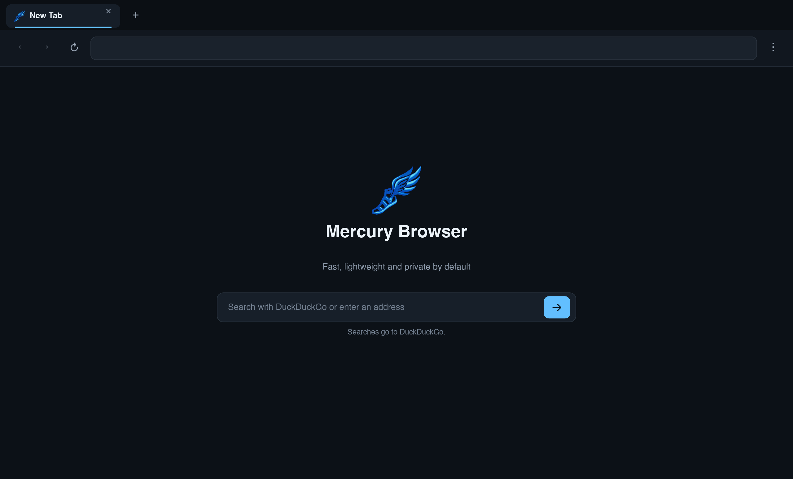

# Start browsing

Mercury opens with a new tab. Its search field and the address bar at the top both take either a web address or words to search for.



To open a particular page at start-up, give its address on the command line; each address opens in its own tab:

```bash
"/Applications/Mercury Browser.app/Contents/MacOS/mercury-browser" https://servo.org/
```

## Open a website

Type any of these into the address bar and press ++return++:

```text
https://servo.org/
servo.org
localhost:8080
127.0.0.1:3000
file:///Users/you/page.html
```

Mercury opens `http`, `https`, `file` and `about` addresses. Text without a scheme is treated as an address when it looks like a host name (it contains a dot, or is `localhost` or an IP address), and `https://` is added in front. Anything else is a search.

## Search the web

Type words that don't look like an address:

```text
how does the Servo web engine work
```

Mercury sends them to your search engine, DuckDuckGo unless you choose another. To use a different engine for one search, start with its keyword:

```text
@wikipedia Servo (software)
```

| Engine | Keyword |
| --- | --- |
| DuckDuckGo (the default) | `@duckduckgo` |
| Bing | `@bing` |
| Brave Search | `@brave` |
| Ecosia | `@ecosia` |
| Google | `@google` |
| Startpage | `@startpage` |
| Wikipedia (en) | `@wikipedia` |

You can change the default engine, and add, edit or remove your own engines (a name, an optional keyword and a URL containing `{searchTerms}`), in **Settings → General**. The keyword must be the first word, followed by the search.

## Work with tabs

- **New tab:** the **+** button or ++cmd+t++.
- **Switch:** click a tab, use ++ctrl+tab++ and ++ctrl+shift+tab++, or ++cmd+1++ to ++cmd+8++ for the first eight tabs and ++cmd+9++ for the last.
- **Close:** the tab's **×** or ++cmd+w++. Closing the last tab quits Mercury. A page that closes its own last tab is replaced by a blank tab instead.
- **Links:** right-click a link and choose **Open link in new tab**. A page can open a tab of its own (`target="_blank"`, `window.open`) only in response to a click or key press in that page. Otherwise Mercury blocks it and shows **Pop-up blocked** in the toolbar, naming the site, with a button to allow pop-ups from it.

Every tab has its own Servo web view. Tabs you aren't looking at are throttled, but they stay in memory.

There is no session restore yet: when Mercury quits, its open tabs are gone. Reopening closed tabs, history, bookmarks and the downloads list are being merged and will appear in later builds.

## Zoom and full screen

++cmd+equal++, ++cmd+minus++ and ++cmd+0++ zoom the page in, out and back to 100 %. The ⋮ browser menu shows the current zoom. **Settings → General → Default page zoom** sets the zoom new pages start at.

**View → Enter Full Screen** (++ctrl+cmd+f++) makes the window full screen. When a page asks to go full screen (a video player, for example), ++escape++ leaves it.

## Settings

Open the settings window with ++cmd+comma++, from **Mercury Browser → Settings…**, or from the ⋮ menu. Changes are saved as you make them; a text field is saved when you press ++return++ or leave it. ++escape++ or ++cmd+w++ closes the window.

| Section | What you can set |
| --- | --- |
| General | What opens at start-up (a new tab or the home page), the home page, the default page zoom, the search engine and your own engines |
| Appearance | Theme (Follow the system, Light or Dark) for Mercury's own windows and the colour scheme pages are told to use; the home button |
| Privacy and security | Blocking ads and trackers; blocking pop-up windows; what to clear when Mercury quits (cookies and site data, cached files) |
| Advanced | Experimental web features and drawing canvases on the GPU; both take effect at the next start |

Some settings are already in the window but do nothing yet, because the feature behind them is still being merged. Their notes say so:

- **The tabs from last time** at start-up (session restore);
- **Show the bookmarks bar** (bookmarks);
- **Browsing history** under "When Mercury Browser quits, clear" (history), and the **Clear browsing data…** button;
- the **Downloads** and **Passwords** sections (their windows);
- **Show search suggestions while typing**, which is greyed out;
- **Language**: Mercury is only in English for now.

## Where your data is kept

Your profile is `~/Library/Application Support/Mercury Browser/Default`: settings, cookies and site data. The HTTP cache is in `~/Library/Caches/io.github.thepigdestroyer.mercury-browser/Default/http-cache`. Only one copy of Mercury can use a profile at a time.
